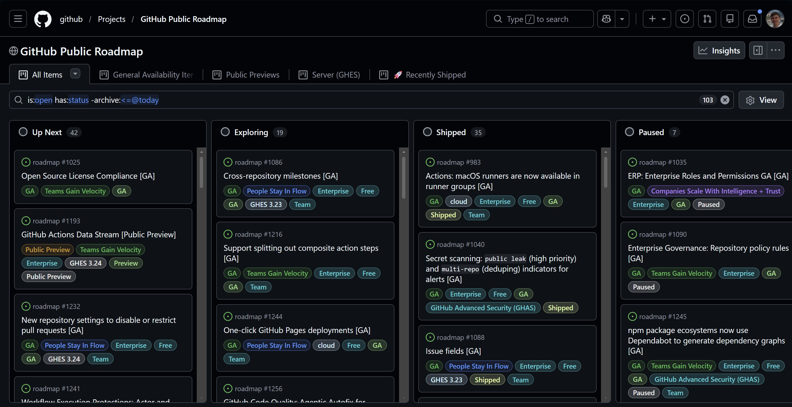
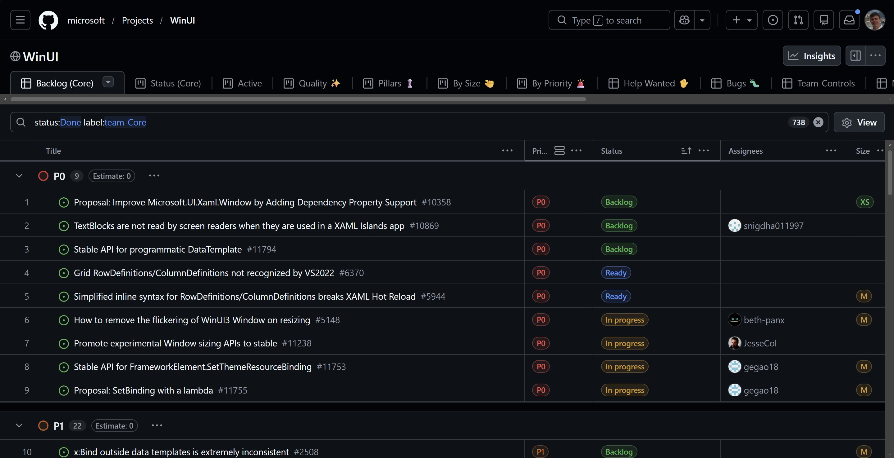

# GitHub Projects Tweaks

A Chrome extension that makes GitHub Projects boards easier to work with:

- **Board column width** (50–100% of GitHub's 350 px, 80% by default): more columns fit on the screen, the font size stays the same.
- **Compact header**:
  - hides the project title (the breadcrumb above already shows it) and lifts the view tabs into its place, with the action buttons on the same row;
  - Insights, Updates and Workflows show only their icon (and counter), the label moves to the tooltip;
  - the icon-only Project details button gets a "Readme" label;
  - the global GitHub header has 25% less vertical padding.
- **Profile names instead of logins**: wherever GitHub prints a login next to an avatar (table, grouping, slice panel), the name from the user's GitHub profile is shown. The login stays in the tooltip. Users without a profile name keep their login.

It only acts on `github.com/orgs/*/projects/*` and `github.com/users/*/projects/*` pages; the rest of github.com is left alone.

## Screenshots

**Board:** the project title is gone, the view tabs and buttons share one row, and the narrower columns fit the whole board on screen.

| Before | After |
|---|---|
|  |  |

**Table:** assignees show profile names instead of logins (`beth-panx` → Beth Pan, `gegao18` → George Gao).

| Before | After |
|---|---|
|  |  |

**Settings popup:**

## Installation

1. Open `chrome://extensions`.
2. Turn on **Developer mode** in the top right corner.
3. Click **Load unpacked** and select this folder.
4. Pin the extension icon to the toolbar and open any project board.

Settings are in the extension popup (click the icon). They apply immediately and sync across your Chrome browsers.

After pulling changes, click **Reload** on the extension card in `chrome://extensions` and reload the project page.

## How it works

| File | Purpose |
|---|---|
| `src/content.js` | Turns itself on for project pages (GitHub is a single-page app, so the URL is checked every 0.5 s), puts classes on `<html>`, watches the DOM |
| `src/content.css` | Column width and compact header |
| `src/names.js` | Replaces logins with profile names |
| `src/settings.js` | Default settings shared by the page and the popup |
| `popup/` | Settings popup |

Names come from the same user card GitHub shows on hover (`/users/{login}/hovercard`): the request uses your session, needs no token and has no API rate limit. Names are cached for 7 days; **Refresh names** clears the cache.

GitHub's class names are generated and change between releases, so the selectors rely on ids, roles and data attributes (`[data-board-column]`, `[role="navigation"][aria-label="Project"]`, `#memex-project-view-root`, `img[data-testid="github-avatar"]`). If something stops working after a GitHub update, start there.
