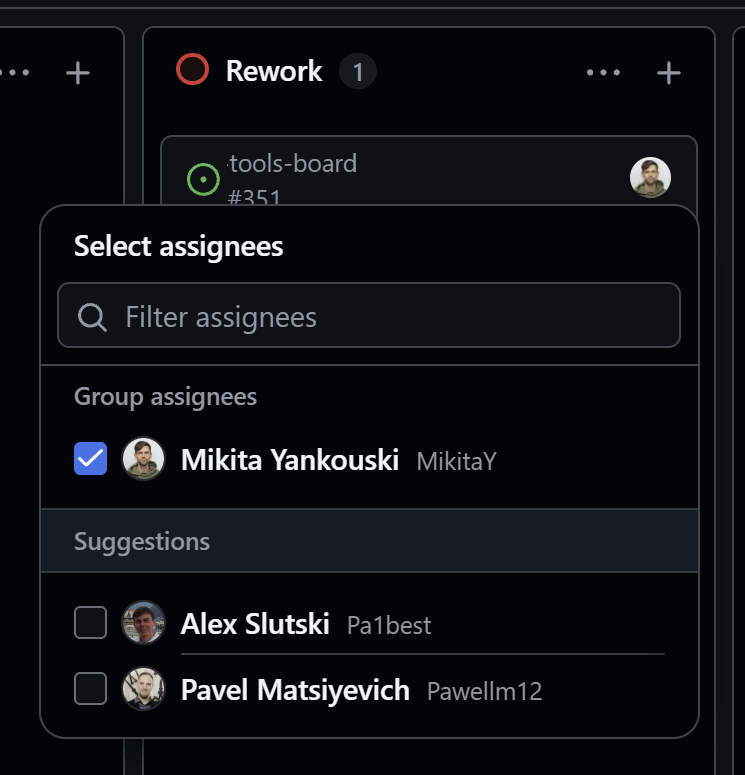

# GitHub Projects Tweaks

A Chrome extension that makes GitHub Projects boards easier to work with. It only acts on `github.com/orgs/*/projects/*` and `github.com/users/*/projects/*` pages; the rest of github.com is left alone.

## Overview

### Board

The project title is gone, the view tabs and buttons share one row, and the narrower columns fit the whole board on screen.

**Before**

**After**

### Table

The same compact header, and assignees show profile names instead of logins.

**Before**

**After**

## What it changes

### Compact header

- The project title is hidden: the breadcrumb at the top already shows it.
- The view tabs move up into its place, and the action buttons sit on the same row, vertically centred.
- A little breathing room (3 px) stays above the tabs.
- The global GitHub header is 48 px tall instead of 64 px (8 px vertical padding instead of 16 px), and the line under it is gone, so it runs straight into the view tabs.
- On board views the filter bar sits 8 px from the tabs and from the columns, and the side gutters around the board are 8 px instead of 16 px.
- Together this gives the board about 77 px more height.

**Before**

**After**

### Top bar buttons

- **Insights**, **Updates** and **Workflows** show only their icon; Workflows keeps its counter. The label moves to the tooltip.
- The icon-only **Project details** button gets a **Readme** label, since that is what it opens.

| Before | After |
|---|---|
|  |  |

### Narrower board columns

- Column width is adjustable from 50% to 100% of GitHub's fixed 350 px, 80% by default.
- More columns fit on the screen, so there is less scrolling left and right.
- The font size stays the same; long titles wrap onto more lines instead.

**Before**

**After**

### Profile names instead of logins

- Wherever GitHub prints a login next to an avatar (table cells, group headers, the slice panel), the name from the user's GitHub profile is shown: `beth-panx` → Beth Pan, `gegao18` → George Gao.
- The login stays in the tooltip.
- Users without a name in their profile keep their login.
- In the **Select assignees** picker and the **Assignees** list of the item panel the name comes first in bold, with the login after it in small grey text.

| Before | After |
|---|---|
|  |  |

### Change assignees from the board

- Hovering over a board card shows a small person button next to the assignee avatars (or in the top right corner of a card without assignees).
- It opens GitHub's own **Select assignees** picker right under the card, as Jira does. Picking people and closing the picker saves the change, exactly as in the item panel.
- Clicking the avatar itself still filters the board by that person.
- Can be switched off in the popup: **Change assignees from a button on board cards**.

### Settings

All of it can be tuned or switched off in the extension popup:

## Installation

1. Open `chrome://extensions`.
2. Turn on **Developer mode** in the top right corner.
3. Click **Load unpacked** and select this folder.
4. Pin the extension icon to the toolbar and open any project board.

Settings are in the extension popup (click the icon). They apply immediately and sync across your Chrome browsers.

After pulling changes, click **Reload** on the extension card in `chrome://extensions` and reload the project page.

## How it works

| File | Purpose |
|---|---|
| `src/content.js` | Turns itself on for project pages (GitHub is a single-page app, so the URL is checked every 0.5 s), puts classes on `<html>`, watches the DOM |
| `src/content.css` | Column width, compact header, board gutters, the assignee button and picker placement |
| `src/names.js` | Replaces logins with profile names |
| `src/assignees.js` | Assignee button on board cards |
| `src/settings.js` | Default settings shared by the page and the popup |
| `popup/` | Settings popup |

Names come from the same user card GitHub shows on hover (`/users/{login}/hovercard`): the request uses your session, needs no token and has no API rate limit. Names are cached for 7 days; **Refresh names** clears the cache.

The assignee picker only exists in the item side panel, so the card button opens the panel through its URL (`?pane=issue&itemId=…`, the id is the card's `data-board-card-id`), keeps it hidden, presses its **Edit Assignees** button and moves the picker next to the card. The panel slides in, and the picker moves with it, so the real picker stays transparent until the panel's animations end and its position holds still for a few frames; meanwhile a static copy of it (a DOM clone) stands at the final place. When the picker closes, the hidden panel is closed with its **Close panel** button (found by its tooltip: the panel also has a **Close issue** button).

In the assignee picker the names are already there as descriptions, so only CSS swaps them with the logins. In the item panel's **Assignees** list `names.js` writes the name and keeps the login in `data-gpe-login`, which CSS shows after it.

GitHub's class names are generated and change between releases, so the selectors rely on ids, roles and data attributes (`[data-board-column]`, `[role="navigation"][aria-label="Project"]`, `#memex-project-view-root`, `img[data-testid="github-avatar"]`, `[data-board-card-id]`, `[role="dialog"][aria-label^="Side panel"]`, `[data-testid="issue-assignees"]`). If something stops working after a GitHub update, start there.
